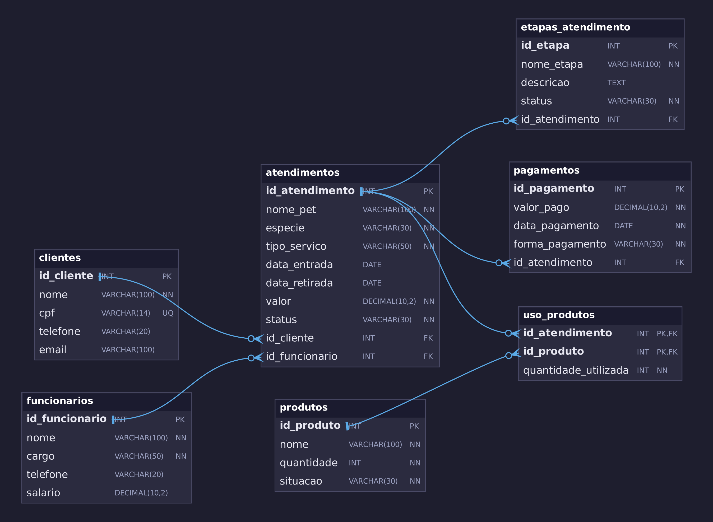
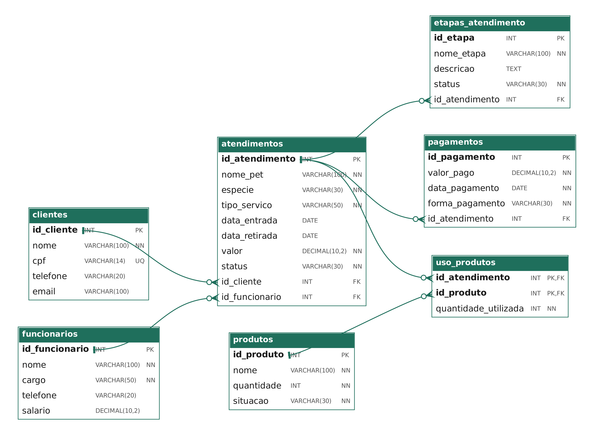

# 🐾 Pet Care — Banco de Dados para Petshop

Projeto final da disciplina **Modelagem de Banco de Dados** (Grupo 03).

Banco de dados relacional para gerenciar a operação de um petshop fictício, o **Pet Care**: clientes (tutores), funcionários, atendimentos (banho e tosa, consultas, vacinação e hospedagem), etapas de cada serviço, pagamentos e consumo de produtos.

## 📌 Sobre o projeto

O petshop precisa acompanhar em um único lugar:

- quem é o tutor de cada pet atendido;
- qual funcionário é responsável pelo atendimento;
- em que etapa do serviço o atendimento está;
- quanto o cliente já pagou e quanto falta;
- quais produtos do estoque foram utilizados.

## 🛠️ Tecnologias

- **SGBD:** MySQL 8.0.16+ ou MariaDB 10.2.1+ (necessário para as restrições `CHECK`)
- **Modelagem:** [dbdiagram.io]((https://dbdiagram.io/e/6aeb433cf1d298b573647b60/6aeba8a47ded3580faad8f7e))
- **Versionamento:** Git e GitHub
- **Ferramentas de execução:** MySQL Workbench ou DBeaver

## 📁 Arquivos do repositório

| Arquivo | Descrição |
|---|---|
| `pet_care.sql` | Script completo: criação do banco, tabelas, dados de teste, consultas e relatórios |
| `pet_care.dbml` | Código do DER para importar no dbdiagram.io |
| `der.png` | Imagem do Diagrama Entidade-Relacionamento (DER) |
| `projeto_logico.png` | Imagem do Projeto Lógico (modelo relacional) |

## 🔗 Links

- **DER (dbdiagram.io):** [abrir diagrama](https://dbdiagram.io/e/6aeb433cf1d298b573647b60/6aeba8a47ded3580faad8f7e)
- **Projeto Lógico:** [projeto_logico.png](projeto_logico.png)

## 🗂️ Modelo de dados

O banco possui **7 tabelas**:

| Tabela | Função |
|---|---|
| `clientes` | Tutores dos pets |
| `funcionarios` | Equipe do petshop (veterinários, tosadores, banhistas, atendentes) |
| `atendimentos` | Serviço prestado a um pet (pertence a um cliente e a um funcionário) |
| `etapas_atendimento` | Etapas de cada atendimento (ex.: banho, tosa, vacinação) |
| `pagamentos` | Pagamentos vinculados a um atendimento |
| `produtos` | Produtos e insumos em estoque |
| `uso_produtos` | Tabela associativa N:N entre atendimentos e produtos |

### Relacionamentos

- `clientes` 1:N `atendimentos`
- `funcionarios` 1:N `atendimentos`
- `atendimentos` 1:N `etapas_atendimento`
- `atendimentos` 1:N `pagamentos`
- `atendimentos` N:N `produtos` (via `uso_produtos`)

### DER

### Projeto Lógico

## 📋 Regras de negócio

- Cada atendimento pertence a exatamente um cliente e tem exatamente um funcionário responsável.
- O CPF do cliente, quando informado, não pode se repetir.
- O valor do atendimento e o salário do funcionário não podem ser negativos.
- Todo pagamento deve ter valor maior que zero e estar vinculado a um atendimento.
- Ao excluir um atendimento, suas etapas e o uso de produtos são excluídos junto (`ON DELETE CASCADE`).
- Atendimentos com pagamentos registrados não podem ser excluídos, o que preserva o histórico financeiro.
- Valores padrão: atendimento novo = `Agendado`; etapa nova = `Pendente`; produto novo = `Em estoque`.

## ▶️ Como executar

1. Tenha um servidor MySQL 8.0.16+ ou MariaDB 10.2.1+ em execução.
2. Abra o `pet_care.sql` no MySQL Workbench (**File → Open SQL Script**) ou no DBeaver.
3. Execute o script inteiro (⚡ ou `Ctrl+Shift+Enter` no Workbench).
4. Atualize a lista de *Schemas*: o banco `pet_care` estará criado e populado.

> ⚠️ **Atenção:** o script começa com `DROP DATABASE IF EXISTS pet_care;`, que apaga e recria o banco de mesmo nome. Não execute em um servidor com um banco `pet_care` que você queira manter.

## 🧾 Conteúdo do script

| Parte | Conteúdo |
|---|---|
| 1 | Criação do banco (`utf8mb4`) |
| 2 a 7.1 | Criação das tabelas, chaves e restrições |
| 8 | Inserção de dados de teste (fictícios) |
| 9 | Consultas simples |
| 10 | Consultas com `INNER JOIN` |
| 11 | Atualização (`UPDATE`) |
| 12 | Exclusão (`DELETE`) |
| 13 | Relatórios com `SUM`, `COUNT`, `LEFT JOIN` e `COALESCE` |

### Exemplo de relatório (parte 13.2)

| Atendimento | Valor contratado (R$) | Recebido (R$) | Saldo a receber (R$) |
|---|---|---|---|
| Thor | 120,00 | 120,00 | 0,00 |
| Mel | 280,00 | 150,00 | 130,00 |
| Bolinha | 600,00 | 300,00 | 300,00 |
| Luna | 70,00 | 0,00 | 70,00 |

## 🚀 Possíveis evoluções

- Criar índices para consultas frequentes.
- Separar os pets em uma tabela própria, ligada ao cliente.
- Controlar os status por chave estrangeira, em vez de texto livre.
- Criar perfis de acesso para os usuários do sistema.

---

*Projeto acadêmico. Todos os dados são fictícios.*
